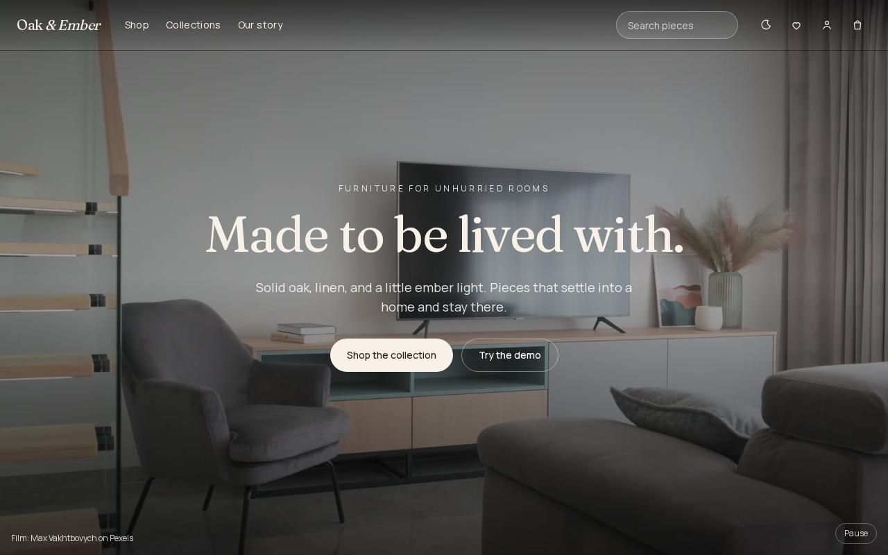
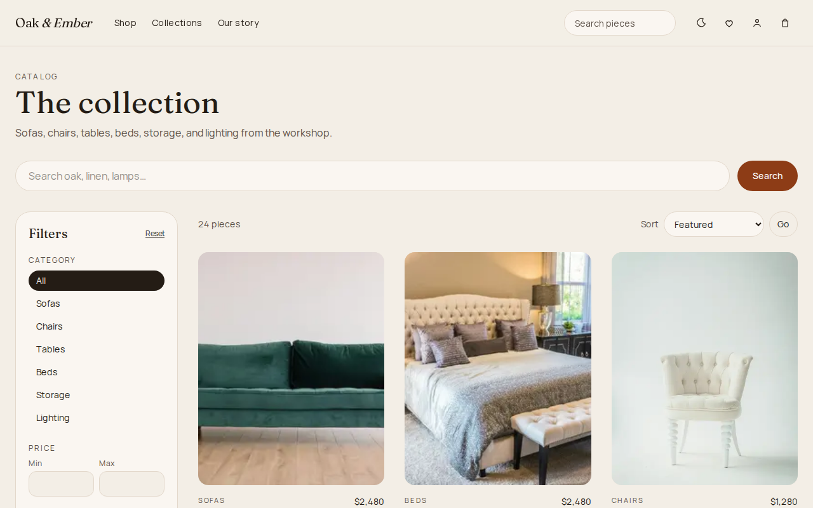
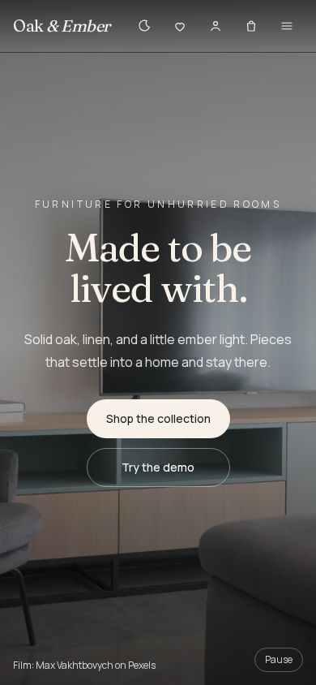
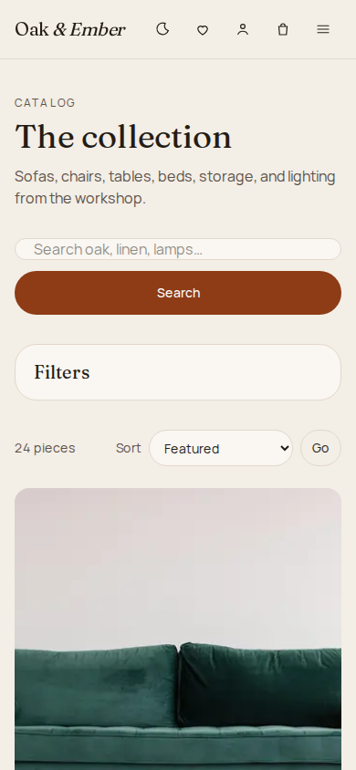
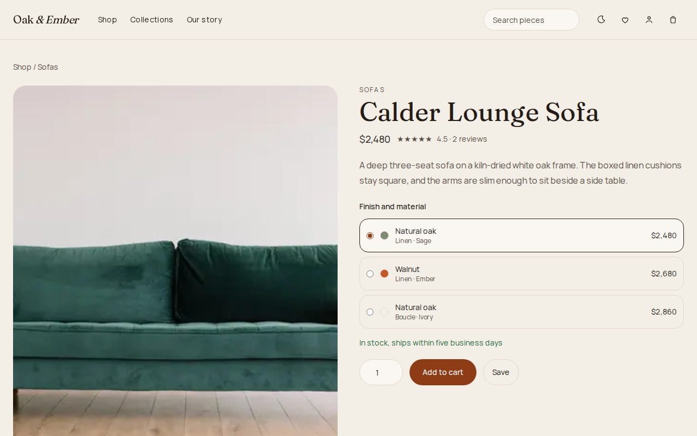
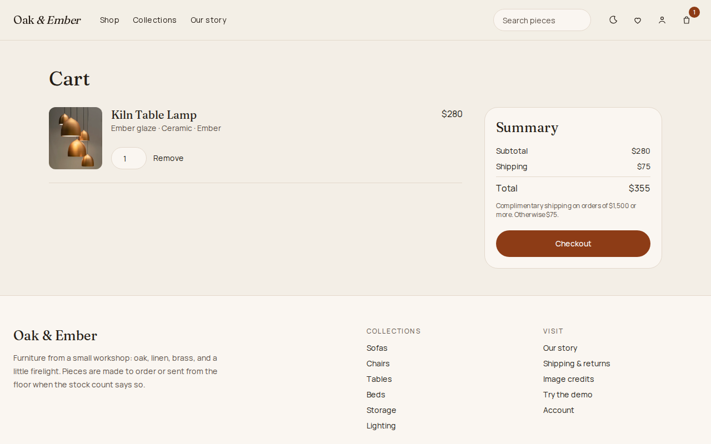
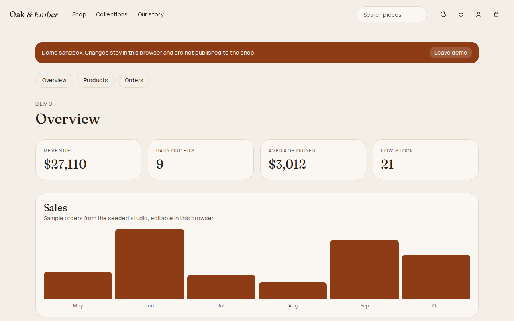
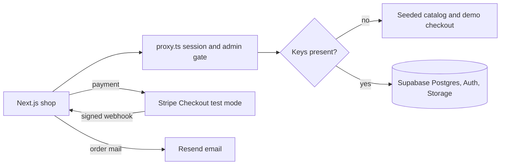

# Oak & Ember

[](https://github.com/JoshuaMColon/oak-and-ember/actions/workflows/ci.yml)

A furniture shop for oak, linen, and warm light. Browse a seeded catalog, keep a guest cart, check out, and open the studio as a guest. When Supabase and Stripe keys are present, the same screens use Postgres, email auth, Storage, and Stripe test mode.

The app builds and runs with no keys at all.

## Screenshots

| Home | Catalog |
| --- | --- |
|  |  |
|  |  |

| Piece | Cart | Studio |
| --- | --- | --- |
|  |  |  |

Phone views of the product, cart, and studio are in `docs/screenshots/` as `product-mobile.png`, `cart-mobile.png`, and `admin-mobile.png`.

## Features

- Full-screen film hero, featured collections, best sellers, and a short brand story.
- Catalog with category pages, search, filters for category, price, material, and color, sorting, and pagination.
- Product pages with a gallery, finish picker, stock, star reviews, related pieces, and add to cart.
- Guest cart in the browser, merged into the database cart after login when Supabase is connected.
- Checkout that opens a Stripe Checkout Session when `STRIPE_SECRET_KEY` is set, and a simulated paid order when it is not.
- Stripe webhook that verifies the signature, writes the order, and decrements stock.
- Order email through Resend, skipped cleanly when the key is missing.
- Email sign up, log in, and log out, plus order history and a wishlist.
- Admin studio for product edits, image upload, inventory, order status, and a sales chart. Customers cannot open it.
- Guest demo at `/demo` that opens the studio as a sandbox. Edits stay in that browser.

## Architecture



Without keys, catalog queries run in the app against the seed in `lib/data/catalog.ts`. With `NEXT_PUBLIC_SUPABASE_URL` and `NEXT_PUBLIC_SUPABASE_ANON_KEY`, search uses a Postgres full-text column and the other reads and writes go through row-level security.

Roles live on `oak.profiles`, not in user-editable metadata. Customers can read their own orders. Catalog writes and order status changes require `role = 'admin'`. A trigger blocks a customer from promoting themselves. The Stripe webhook uses the service role key, which never reaches the browser.

## Local setup

```bash
npm install
cp .env.example .env.local
npm run dev
```

Open [http://localhost:3000](http://localhost:3000). Shop without signing in. Use **Try the demo** for the studio.

## Environment variables

| Variable | Where | What it does |
| --- | --- | --- |
| `NEXT_PUBLIC_SITE_URL` | Public | Return URL for Stripe. Defaults to `http://localhost:3000`. |
| `NEXT_PUBLIC_SUPABASE_URL` | Public | Supabase project URL. Required with the anon key before the database is used. |
| `NEXT_PUBLIC_SUPABASE_ANON_KEY` | Public | Publishable anon key. Safe for the browser. RLS still applies. |
| `SUPABASE_SERVICE_ROLE_KEY` | Server | Webhook only. Bypasses RLS to insert the paid order and decrement stock. |
| `STRIPE_SECRET_KEY` | Server | Test-mode secret. Checkout stays simulated until this is set. |
| `STRIPE_WEBHOOK_SECRET` | Server | Signing secret for `/api/webhooks/stripe`. |
| `NEXT_PUBLIC_STRIPE_PUBLISHABLE_KEY` | Public | Reserved for a future card form. Checkout itself is a redirect and does not need it. |
| `RESEND_API_KEY` | Server | Sends the order email. Missing key skips the email. The order still succeeds. |
| `RESEND_FROM_EMAIL` | Server | From address. The free tier's `onboarding@resend.dev` sender can only deliver to the address on the Resend account. |

Copy `.env.example` to `.env.local`. Leave values blank to stay in fallback mode. After you add keys, restart `npm run dev` or redeploy so server-rendered pages pick them up.

## Connect Supabase

1. Create a free project at [supabase.com](https://supabase.com).
2. In the SQL editor, run `supabase/migrations/20261104020000_init.sql`, then `supabase/seed.sql`.
3. In Authentication, add `http://localhost:3000/auth/callback` as a redirect URL. For a quick local trial you can turn off email confirmation.
4. Put the project URL and anon key in `.env.local`.
5. Create an account in the shop, then promote it:

```sql
update oak.profiles
set role = 'admin'
where id = (select id from auth.users where email = '<your email>');
```

The `oak-products` bucket is public to read. Only admins can upload. Authorization uses `oak.is_admin()`, which reads `oak.profiles.role`.

### Shared project layout

All tables, functions, and triggers live in the `oak` schema so the store can share a Supabase project with other apps. The Data API only exposes `public`, so each table is reached through a `security_invoker` view named `public.oak_<table>`; RLS on the `oak` tables still applies. There is no `auth.users` trigger: the profile row is created on the first signed-in visit (`lib/access.ts`). Sign in once before promoting yourself to admin.

Regenerate the seed after catalog edits with `npm run seed:sql`.

## Connect Stripe

1. Use a [Stripe test-mode](https://dashboard.stripe.com/test/apikeys) secret key as `STRIPE_SECRET_KEY`.
2. Forward webhooks:

```bash
stripe listen --forward-to localhost:3000/api/webhooks/stripe
```

3. Put the printed signing secret in `STRIPE_WEBHOOK_SECRET`, and the service role key in `SUPABASE_SERVICE_ROLE_KEY` so the webhook can write the order.
4. Pay with `4242 4242 4242 4242`, any future date, and any CVC.

The webhook rejects a bad signature with HTTP 400. Without the webhook secret the route returns 503 and does not invent an order.

## Tests

```bash
npm run lint
npm run typecheck
npm test
npm run build
npm run test:e2e
```

Unit tests cover search, filters, cart merge, shipping, and the sales totals. Playwright covers browsing, search, demo checkout, the admin redirect, and the guest demo. GitHub Actions runs the same sequence on Node 22. End-to-end tests do not need keys.

## Credits

The hero film is [Interior Design of a Living Room](https://www.pexels.com/video/interior-design-of-a-living-room-7239166/) by Max Vakhtbovych on Pexels. Product photographs are Unsplash URLs. The shop lists both at `/credits`.

## What stays local until you add keys

- The catalog, reviews, and sample studio orders are the files under `lib/data`.
- The cart, wishlist, demo reviews, and demo checkout orders stay in `localStorage`.
- The guest studio can edit stock, products, and order status in that browser only. The public shop does not change.
- Sign-up and log-in forms explain that accounts need Supabase, and they do not pretend a session was created.
- Image upload returns an error until Storage is configured. The product form still accepts an image URL.
- Resend is not called when `RESEND_API_KEY` is empty.
